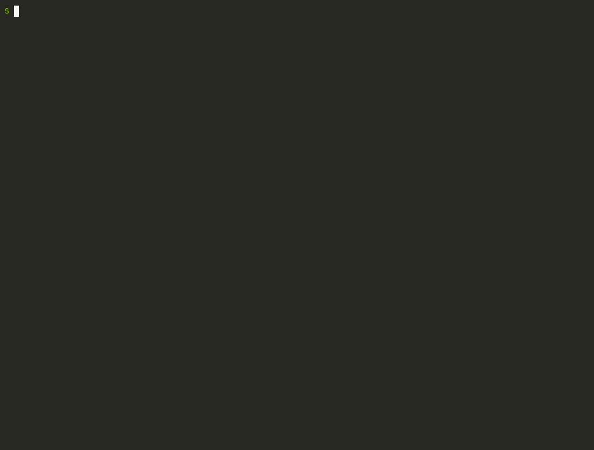
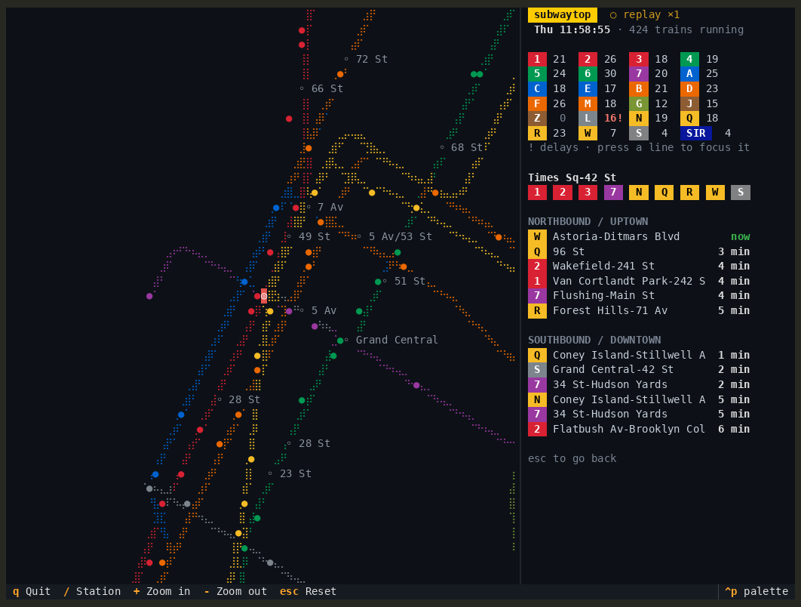

<h1 align="center">subwaytop</h1>

<p align="center"><b>Every NYC subway train, live, in your terminal.</b><br>
A real-time map of the whole system, departure boards for any station, and service alerts, straight from the MTA's open feeds. No API key, no signup.</p>

<p align="center">
  <a href="https://pypi.org/project/subwaytop/"></a>
  <a href="https://github.com/ArkaKhorchidian/subwaytop/actions/workflows/ci.yml"></a>
  
  <a href="LICENSE"></a>
</p>

```bash
uvx subwaytop               # the live map
uvx subwaytop "union sq"    # a station's departures
```

<p align="center">
  
  <br><sub>Real MTA data recorded on a weekday at noon, replayed at 30× so you can see the trains move.</sub>
</p>

## What you get

- **A live map of every train** (usually 400–600 of them), each in its line's color, moving between stations as it goes
- **Departure boards**: press `/` and type a station. Complexes like Times Sq are merged the way riders think of them
- **Service alerts**, with delayed lines flagged in the legend
- **Focus on one line**: press its letter or number (`L`, `7`, `A`…) to dim everything else
- Zoom and pan the map; station names appear as you zoom in

<p align="center"></p>

## Keys

| | |
|---|---|
| `/` | open a station's departures |
| `+` `-` | zoom |
| arrows or `h` `j` `k` `l` | pan |
| `1`–`7`, `A`–`Z` | focus a line (press again to clear) |
| `esc` | back to the full map |
| `q` | quit |

## More

```bash
subwaytop --line L                     # start focused on one line
subwaytop "bedford av" --board         # print departures once and exit (handy in scripts)
subwaytop --record rush-hour --minutes 60  # save the feeds every 30 s...
subwaytop --replay rush-hour --speed 30    # ...and watch rush hour in two minutes
```

## How it works

- The MTA publishes [GTFS-realtime](https://gtfs.org/realtime/) feeds for every subway line, refreshed about every 30 seconds.
  subwaytop decodes them with a tiny built-in protobuf reader (tested field by field against Google's official bindings),
  so the only dependency is [Textual](https://github.com/Textualize/textual).
- The feeds say when each train will reach each upcoming stop. subwaytop places every train between its previous and next
  station according to those predictions, so trains glide along instead of jumping from stop to stop.
- Station locations, line shapes, colors and typical travel times come from the MTA's static GTFS, condensed into a 160 KB
  file that ships with the package (`tools/build_static.py` rebuilds it).
- The map is drawn with braille characters, eight dots per terminal cell, in any terminal with true color.

## License

MIT. Transit data © MTA, used under the MTA's open data terms. subwaytop is not affiliated with or endorsed by the MTA.
